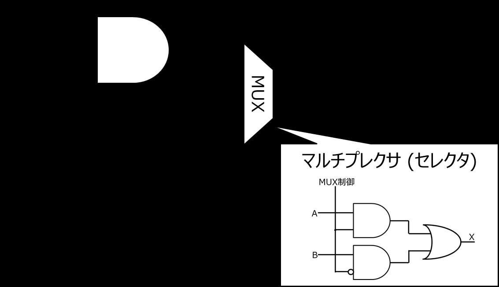
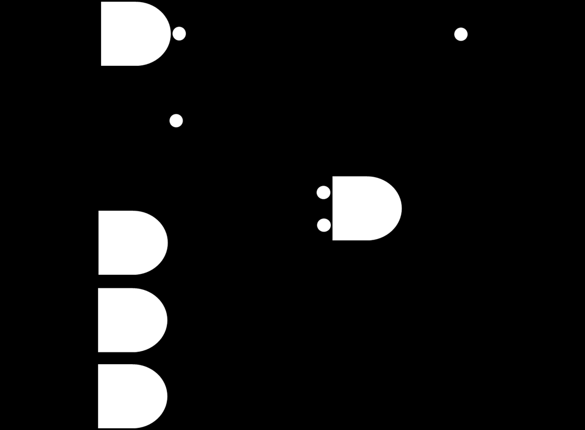
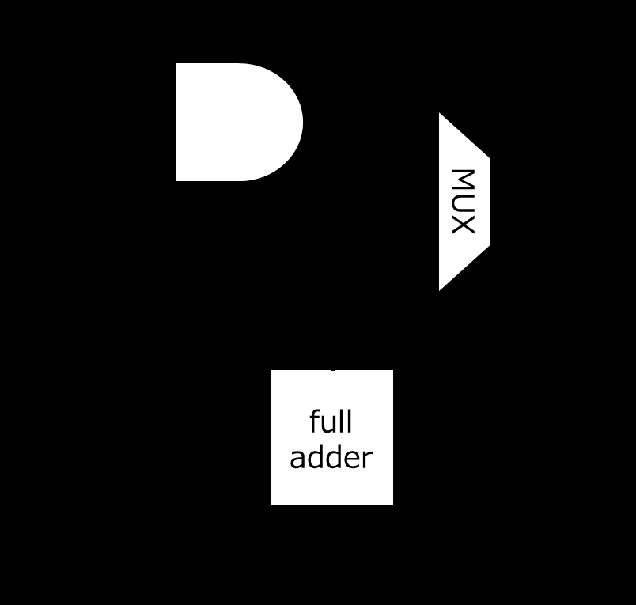

<!-- page 1 -->
# 計算機構成論 第10回

―算術演算の実行(1)―  
大連理工大学・立命館大学 国際情報ソフトウェア学部  
双見京介

<!-- page 2 -->
## 講義内容

算術演算の実行  
2進数の加算・減算・AND/OR演算  
  シフト演算、符号拡張  
算術演算ユニット(ALU)

<!-- page 3 -->
## 2進数の加算 復習

正数＋正数  
00001111 1510  
\+ 00000010 210 正しい  
00010001 1710  
01111110 12610  
\+ 00000010 210 桁あふれ  
(オーバーフロー:overflow)  
10000000 12810  
どのように対処するかは、  
プログラミング言語等による  
これは-128

<!-- page 4 -->
## 確認問題

000111102+000100102 を  
2進数の筆算で計算し、10進数で答えよ。  
011001102-000110002 の結果を  
10進数で答えよ。

<!-- page 5 -->
## 確認問題

000111102+000100102 を  
2進数の筆算で計算し、10進数で答えよ。  
00011110 3010  
\+ 00010010 1810  
00110000 **4810**  
011001102-000110002 の結果を10進数で答えよ。  
1の補数 2の補数  
00011000 11100111 11101000  
01100110 10210  
\+ 11101000 -2410  
01001110 **7810**

<!-- page 6 -->
## 2進数の負数表現 -2の補数- 復習

4ビットでは  
表現不可能

| 10進数 | 2進数 |
| ---- | ---- |
| -8 | 1000 |
| -7 | 1001 |
| -6 | 1010 |
| -5 | 1011 |
| -4 | 1100 |
| -3 | 1101 |
| -2 | 1110 |
| -1 | 1111 |
| -0 | 0000 |

| 10進数 | 2進数 |
| ---- | ---- |
| 8 | - |
| 7 | 0111 |
| 6 | 0110 |
| 5 | 0101 |
| 4 | 0100 |
| 3 | 0011 |
| 2 | 0010 |
| 1 | 0001 |
| 0 | 0000 |

1の補数+1

<!-- page 7 -->
## 2進数の減算 復習

正数＋負数 を行えば良い  
00001111 1510  
\+ 11111110 -210 正しい  
00001101 1310  
ここの繰り上がりは無視  
00001111 1510  
\+ 11101101 -1910 正しい  
11111100 -410  
正数＋負数ではオーバーフローは発生しない

<!-- page 8 -->
## 2進数の減算 復習

負数＋負数 の場合  
11110001 -1510  
\+ 11111110 -210 正しい  
11101111 -1710  
10000011 -12510  
\+ 11111100 -410 オーバーフロー  
01111111 -12910  
これは127

<!-- page 9 -->
## AND, OR演算

AND演算  
11110001  
& 00110110 両ビットが1の桁は1、  
それ以外は0になる  
00110000  
OR演算  
11110001  
| 00110110 それ以外は0になる  
どちらかのビットが1の桁は1、  
11110111

<!-- page 10 -->
## 確認問題

010101012 & 111100002 を計算せよ。  
010101012 | 111100002 を計算せよ。  
レジスタ$s0に 1510 が入っている。  
命令 `sll $s0, $s0, 2` を実行すると、  
$s0の中身はどうなるか、2進数で答えよ。  
レジスタ$s0に -210 が入っている。  
命令 `sra $s0, $s0, 1` を実行すると、  
$s0の中身はどうなるか、2進数で答えよ。  
※sraは右算術シフトを行う命令である。

<!-- page 11 -->
## 確認問題

010101012 & 111100002 を計算せよ。  
**01010000**  
010101012 | 111100002 を計算せよ。  
**11110101**  
レジスタ$s0に 1510 が入っている。  
命令 `sll $s0, $s0, 2` を実行すると、  
$s0の中身はどうなるか、2進数で答えよ。  
**0000 0000 0000 0000 0000 0000 0011 1100**  
レジスタ$s0に -210 が入っている。  
命令 `sra $s0, $s0, 1` を実行すると、  
$s0の中身はどうなるか、2進数で答えよ。  
**1111 1111 1111 1111 1111 1111 1111 1111**

<!-- page 12 -->
## シフト演算 (shift operation) 復習

2進数のビットを左右にずらす演算  
000011002 = 8+4 =  1210  
2倍  
000110002 = 16+8 = 2410  
最上位ビット 最下位ビット  
は捨てる には0が入る  
000011002 = 8+4 =  1210  
1/2倍  
000001102 = 4+2 =    610

<!-- page 13 -->
## シフト演算 (shift operation) 復習

左端、右端に注意  
110000002 = 128+64 =  19210  
左に1ビット  
2倍にならない  
シフト  
100000002 =       128 = 12810  
000010012 = 8+1 =  910  
右に1ビット  
シフト  
000001002 =     4 = 410 切り捨て)

1/2倍  
(小数点以下

<!-- page 14 -->
## 算術シフト 復習

符号付きの場合  
算術シフト  
111110002 = -810  
右に1ビット  
シフト  
111111002 = -410  
111110002 = -810  
左に1ビット  
シフト  
111100002 = -1610  
※論理左シフトとみなしても良い

<!-- page 15 -->
## 論理シフト 復習

符号なしの場合  
論理シフト  
111110002 = 24810  
右に1ビット 符号ビットを  
シフト  
考慮しない  
011111002 = 12410  
011110002 = 12010  
左に1ビット  
シフト  
111100002 = 24010

<!-- page 16 -->
## 確認問題

(1) 命令 `addi $s0, $zero, -1` を  
機械語に直せ。  
※`addi`はI形式でopcodeは816  
※$s0 は1016番, $zeroは016番  
(2) (1)の命令の結果、$s0の中身は  
どうなるか、2進数で示せ。

<!-- page 17 -->
## 確認問題

(1) 命令 `addi $s0, $zero, -1` を  
機械語に直せ。  
※`addi`はI形式でopcodeは816  
※$s0 は1016番, $zeroは016番  
(2) (1)の命令の結果、$s0の中身は  
どうなるか、2進数で示せ。  
符号拡張

<!-- page 18 -->
## 2進数の符号拡張 復習

より多いビット数で同じ値を表現する方法  
e.g., 8ビット2進数→16ビット2進数  
新しい値の上位ビットを、元の値の最上位ビットで  
埋めればOK  
負数は2の補数表現が前提  
8bit 00001111  
1510  
16bit 0000000000001111  
8bit 11110001  
\-1510  
16bit 1111111111110001

<!-- page 19 -->
## 講義内容

算術演算の実行  
2進数の加算・減算・AND/OR演算  
  シフト演算、符号拡張  
算術演算ユニット(ALU)

<!-- page 20 -->
## 算術論理演算ユニット

ALU (arithmetic logic unit)  
算術演算 (加算、減算)  
論理演算 (AND, OR)  
などを行う

<!-- page 21 -->
## 論理演算の実現

AND演算、OR演算の実現

<!-- page 22 -->
## 1ビット加算器の実現

全加算器 (下位からの繰り上げあり)

<!-- page 23 -->
## 論理演算と加算が可能なALU

これをつなげていくと  
nビットの演算が可能になる

<!-- page 24 -->
## 減算器の実現

「入力値の2の補数を取る」という  
指定ができる制御信号を導入すれば良い  
→ あとは加算器で加算する  
各ビット反転  
最下位ビットに1を加算

<!-- page 25 -->
## 加減算におけるオーバーフロー判定

| 操作 | オペランドA | オペランドB | 結果 |
| --- | ------ | ------ | --- |
| A+B | 非負 | 非負 | 負 |
| A+B | 負 | 負 | 非負 |
| A-B | 非負 | 負 | 負 |
| A-B | 負 | 非負 | 非負 |

→実際には、もっと簡単に判定可能

結果がすべて  
ではない

<!-- page 26 -->
## 加減算におけるオーバーフロー判定

2の補数を使えば、減算も加算として  
扱えるので、加算のみ考慮  
① 正＋正 ② 負＋負  
00111111 63 11000001 -63  
\+ 00000011 3 + 11111101 -3  
001000010 66 無視 -66  
110111110

<!-- page 27 -->
## 加減算におけるオーバーフロー判定

最上位への繰り上がり、  
最上位からの繰り上がりに着目  
① 正＋正 ② 負＋負  
00111111 63 11000001 -63  
\+ 00000011 3 + 11111101 -3  
001000010 66 -66  
110111110  
**0** **0** **1** **1**

<!-- page 28 -->
## 加減算におけるオーバーフロー判定

最上位への繰り上がり、最上位からの繰り上がりに着目  
① 正＋正 ② 負＋負  
01111111 127 10000001 -127  
\+ 00000011 3 + 11111101 -3  
010000010  
\-126 101111110 126  
**0** **1** **1** **0**  
異なるとオーバーフロー  
2つのビットの**比較**を行えば判定可能  
→ XORゲート(排他的論理和)が使える

<!-- page 29 -->
## MIPSにおけるオーバーフロー対応

加算(add)、即値加算(addi)、減算(sub)時に  
オーバーフロー例外が発生  
符号なし加算(addu)、符号なし即値加算  
(addiu)、符号なし減算(subu)は、  
オーバーフローが発生しても例外にならない  
通常、符号なし整数はメモリアドレスに使用される  
オーバーフローを認識するかどうかは状況依存  
状況によって、認識したり、無視できるように  
命令を選択  
例外プログラムカウンタ(EPC)に例外を  
起こした命令のアドレスが格納される

<!-- page 30 -->
## 確認問題

CPUの中に存在する様々な算術演算を行  
う回路を、**(1)**と呼ぶ。  
加減算におけるオーバーフローを判定  
するには、**(2)** と、**(3)** を見れば良い。

<!-- page 31 -->
## 確認問題

<!-- page 32 -->
## 参考文献

コンピュータの構成と設計 上 第5版  
David A.Patterson, John L. Hennessy 著、  
成田光彰 訳、日経BP社  
コンピュータの構成と設計 下 第5版  
David A.Patterson, John L. Hennessy 著、  
成田光彰 訳、日経BP社  
山下茂 「計算機構成論１」講義資料
