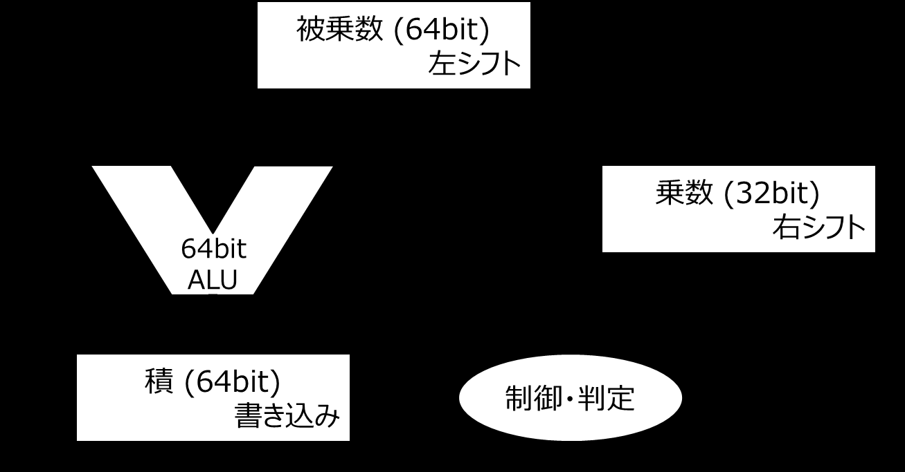
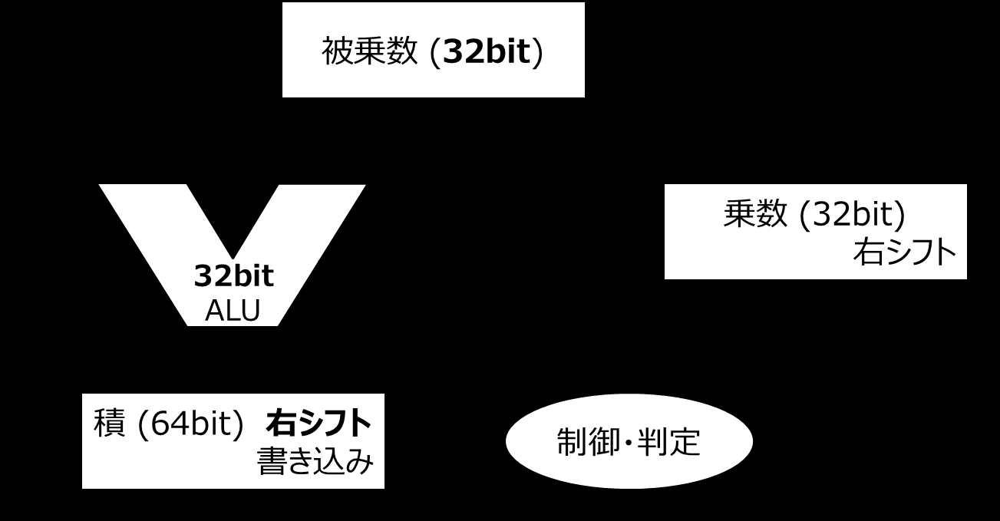
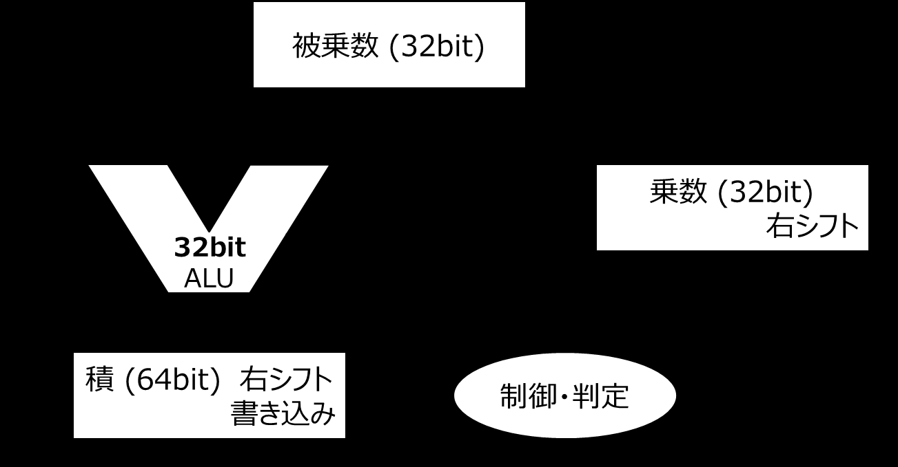
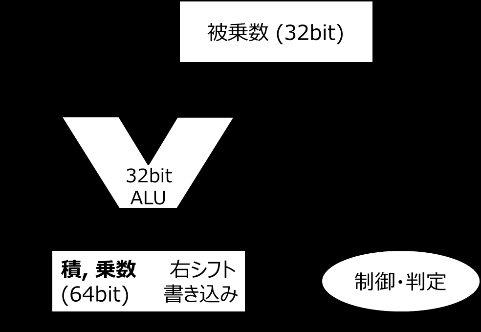
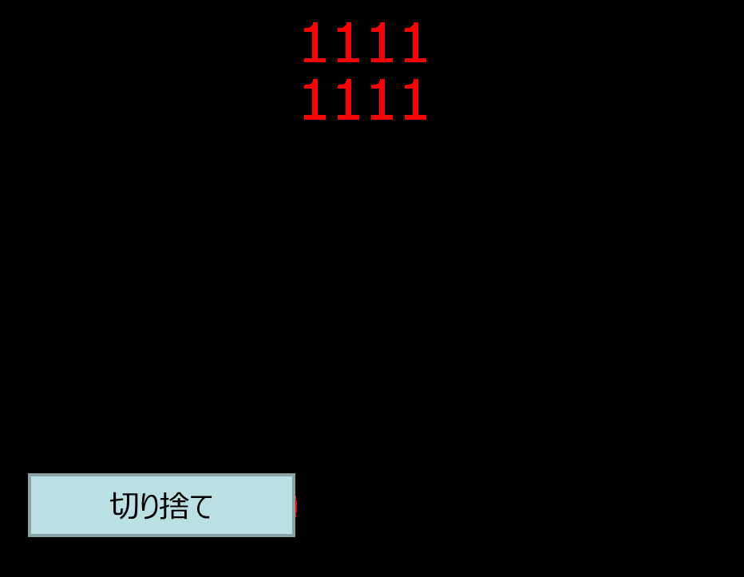
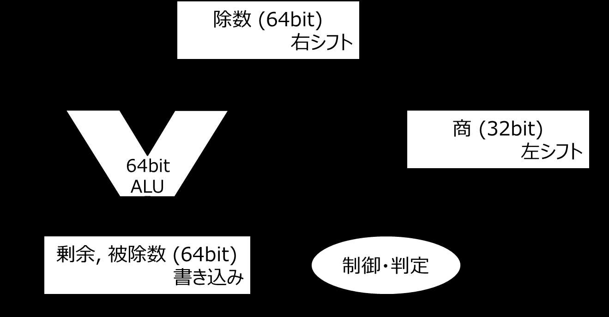
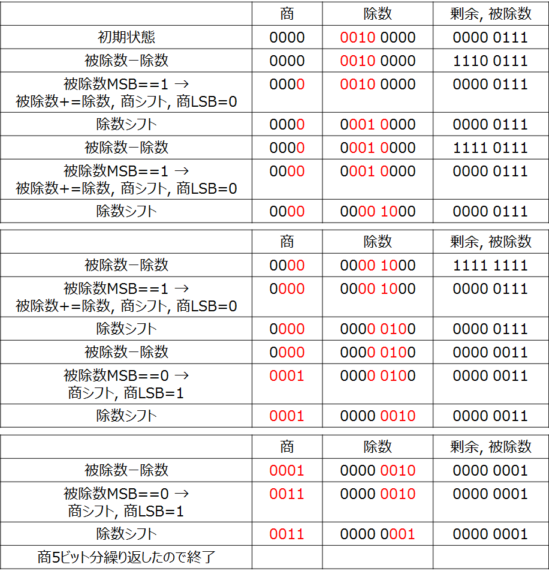
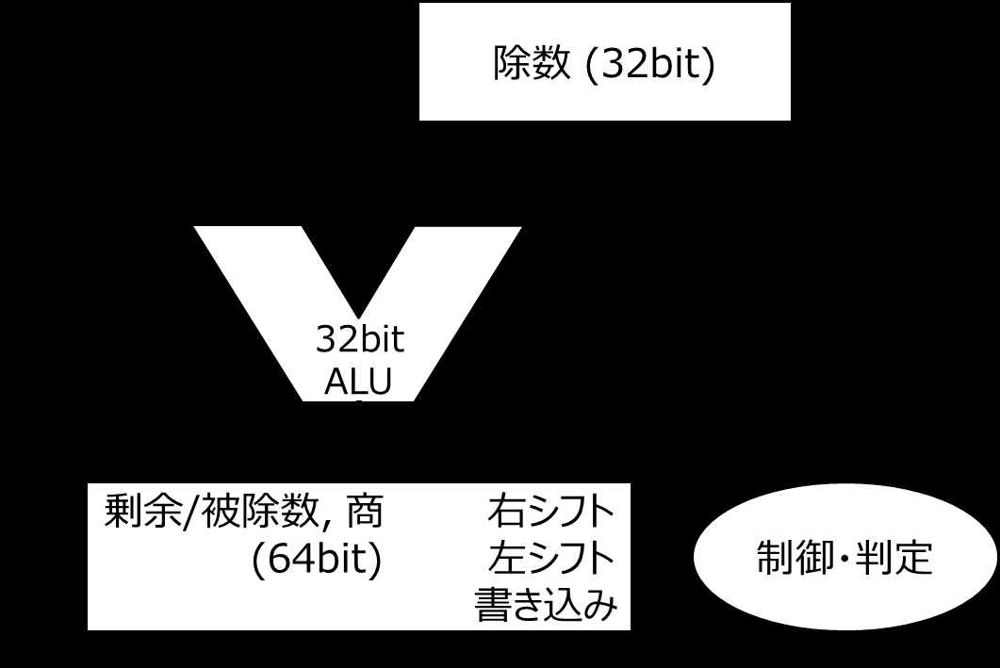
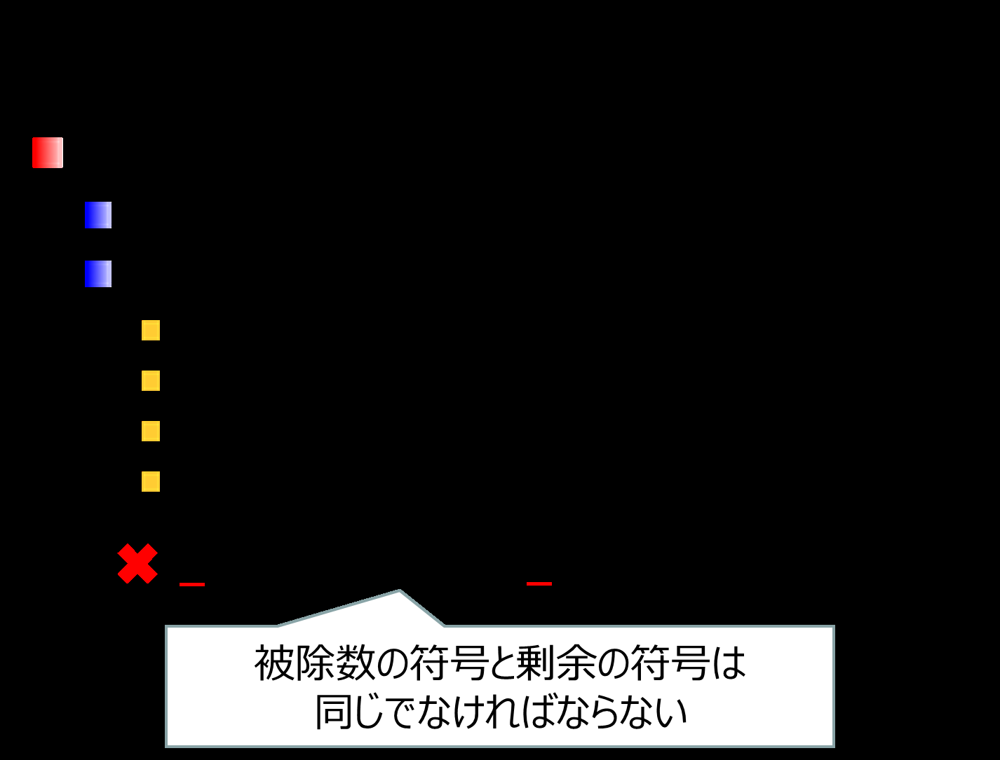

<!-- page 1 -->
# 計算機構成論 第11回

―算術演算の実行(2)―  
大連理工大学・立命館大学 国際情報ソフトウェア学部  
双見京介

<!-- page 2 -->
## 講義内容

算術演算の実行  
2進数の乗算  
2進数の除算

<!-- page 3 -->
## 2進数の乗算

正数×正数  
10進数と同じように筆算ができる  
桁数は乗数の桁数と被乗数の桁数を  
足したものになる  
2m通り×2n通り→2(m+n)通り  
0011 310  …被乗数  
× 0110 610  …乗数  
0000  
0011  
0011  
0000  
00010010 1810 …積

<!-- page 4 -->
## 2進数の乗算

正数×負数  
乗数と被乗数を符号拡張して筆算  
上位ビットを切り捨てる  
**0000**0011 310 符号なしだと…  
× **1111**1010 -610 0011 310  
00000011 ×1010 1010  
00000011 0011  
00000011 000111100011 3010  
00000011  
00000011  
00000011  
**00000010**11101110切り捨て -1810

<!-- page 5 -->
## 2進数の乗算

負数×負数  
正数×負数と同様  
**1111**1101 -310  
× **1111**1010 -610  
11111101  
11111101  
11111101  
11111101  
11111101  
11111101  
**00000000**00010010切り捨て 1810

<!-- page 6 -->
## 乗算回路の実現 第1版



とりあえず正数のみ  
考えます

<!-- page 7 -->
## 乗算回路の実現 第1版


3*6 =18  
0011*0110=

|  | 被乗数 | 乗数 | 積 |
| --------------- | --------- | ---- | --------- |
| 初期状態 | 0000 0011 | 0110 | 0000 0000 |
| 乗数LSB=0 → 何もしない | 0000 0011 | 0110 | 0000 0000 |
| シフト操作 | 0000 0110 | 0011 | 0000 0000 |
| 乗数LSB=1 → 被乗数加算 | 0000 0110 | 0011 | 0000 0110 |
| シフト操作 | 0000 1100 | 0001 | 0000 0110 |
| 乗数LSB=1 → 被乗数加算 | 0000 1100 | 0001 | 0001 0010 |
| シフト操作 | 0001 1000 | 0000 | 0001 0010 |
| 乗数LSB=0 → 何もしない | 0001 1000 | 0000 | 0001 0010 |
| シフト操作 | 0011 0000 | 0000 | 0001 0010 |
| 4ビット分繰り返したので終了 |  |  |  |

<!-- page 8 -->
## 乗算回路の実現 第2版

被乗数、ALUを32ビットに



<!-- page 9 -->
## 乗算回路の実現 第2版



3*6 =18

|  | 被乗数 | 乗数 | 積 |
| --------------- | ---- | ---- | --------- |
| 初期状態 | 0011 | 0110 | 0000 0000 |
| 乗数LSB=0 → 何もしない | 0011 | 0110 | 0000 0000 |
| シフト操作 | 0011 | 0011 | 0000 0000 |
| 乗数LSB=1 → 被乗数加算 | 0011 | 0011 | 0011 0000 |
| シフト操作 | 0011 | 0001 | 0001 1000 |
| 乗数LSB=1 → 被乗数加算 | 0011 | 0001 | 0100 1000 |
| シフト操作 | 0011 | 0000 | 0010 0100 |
| 乗数LSB=0 → 何もしない | 0011 | 0000 | 0010 0100 |
| シフト操作 | 0011 | 0000 | 0001 0010 |
| 4ビット分繰り返したので終了 |  |  |  |

<!-- page 10 -->
## 乗算回路の実現 第3版

乗数を積レジスタの右側に入れる



<!-- page 11 -->
## 乗算回路の実現 第3版


3*6 =18

|  | 被乗数 | 積, 乗数 |
| --------------- | ---- | --------- |
| 初期状態 | 0011 | 0000 0110 |
| 乗数LSB=0 → 何もしない | 0011 | 0000 0110 |
| シフト操作 | 0011 | 0000 0011 |
| 乗数LSB=1 → 被乗数加算 | 0011 | 0011 0011 |
| シフト操作 | 0011 | 0001 1001 |
| 乗数LSB=1 → 被乗数加算 | 0011 | 0100 1001 |
| シフト操作 | 0011 | 0010 0100 |
| 乗数LSB=0 → 何もしない | 0011 | 0010 0100 |
| シフト操作 | 0011 | 0001 0010 |
| 4ビット分繰り返したので終了 |  |  |

<!-- page 12 -->
## 負数を扱う乗算回路

乗数、被乗数とも32bit表現のため、  
負数の場合に適切に符号拡張できない



この筆算と同じこと  
ができない  
解決策：  
負数は正数に変換し、  
積の計算結果に後から符号適用

<!-- page 13 -->
## 確認問題


6*6 = 36

|  | 被乗数 | 積, 乗数 |
| ---- | --- | ----- |
| 初期状態 |  |  |

<!-- page 14 -->
## 確認問題


6*6 = 36

|  | 被乗数 | 積, 乗数 |
| --------------- | --- | ----- |
| 初期状態 |  |  |
| 乗数LSB=0 → 何もしない |  |  |
| シフト操作 |  |  |
| 乗数LSB=1 → 被乗数加算 |  |  |
| シフト操作 |  |  |
| 乗数LSB=1 → 被乗数加算 |  |  |
| シフト操作 |  |  |
| 乗数LSB=0 → 何もしない |  |  |
| シフト操作 |  |  |
| 4ビット分繰り返したので終了 |  |  |

<!-- page 15 -->
## 確認問題


6*6 = 36

|  | 被乗数 | 積, 乗数 |
| --------------- | ---- | --------- |
| 初期状態 | 0110 | 0000 0110 |
| 乗数LSB=0 → 何もしない | 0110 | 0000 0110 |
| シフト操作 | 0110 | 0000 0011 |
| 乗数LSB=1 → 被乗数加算 | 0110 | 0110 0011 |
| シフト操作 | 0110 | 0011 0001 |
| 乗数LSB=1 → 被乗数加算 | 0110 | 1001 0001 |
| シフト操作 | 0110 | 0100 1000 |
| 乗数LSB=0 → 何もしない | 0110 | 0100 1000 |
| シフト操作 | 0110 | 0010 0100 |
| 4ビット分繰り返したので終了 |  |  |

<!-- page 16 -->
## 講義内容

算術演算の実行  
2進数の乗算  
2進数の除算

<!-- page 17 -->
## 2進数の除算

正数／正数  
例) 1310/510 = 2 余り3 = 11012/01012  
(参考) 10進数の場合  
10 2…  
101 ) 1101 5 ) 131  
101 …1*101 10 …2*5  
11 …110-101, 1 031 …13-10, 1  
…  
10進数と同じように筆算できる

<!-- page 18 -->
## 2進数の除算

符号付き除算  
被除数＝商×除数＋剰余  
例)  
(+7)/(+2) = (+3)余り(+1)  
(-7)/(-2) = (+3)余り(-1)  
(-7)/(+2) = (-3)余り(-1)  
(+7)/(-2) = (-3)余り(+1)  
(+7)/(-2) = (-4)余り(-1)  
被除数の符号と剰余の符号は  
同じでなければならない

<!-- page 19 -->
## 除算回路の実現 第1版



<!-- page 20 -->
## 除算回路の実現 第1版


(+7)/(+2) = (+3)余り(+1)

|  | 商 | 除数 | 剰余, 被除数 |
| --------------------------------- | ---- | --------- | --------- |
| 初期状態 | 0000 | 0010 0000 | 0000 0111 |
| 被除数ー除数 | 0000 | 0010 0000 | 1110 0111 |
| 被除数MSB==1 → 被除数+=除数, 商シフト, 商LSB=0 | 0000 | 0010 0000 | 0000 0111 |
| 除数シフト | 0000 | 0001 0000 | 0000 0111 |
| 被除数ー除数 | 0000 | 0001 0000 | 1111 0111 |
| 被除数MSB==1 → 被除数+=除数, 商シフト, 商LSB=0 | 0000 | 0001 0000 | 0000 0111 |
| 除数シフト | 0000 | 0000 1000 | 0000 0111 |

<!-- page 21 -->
## 除算回路の実現 第1版


(+7)/(+2) = (+3)余り(+1)

|  | 商 | 除数 | 剰余, 被除数 |
| --------------------------------- | ---- | --------- | --------- |
| 被除数ー除数 | 0000 | 0000 1000 | 1111 1111 |
| 被除数MSB==1 → 被除数+=除数, 商シフト, 商LSB=0 | 0000 | 0000 1000 | 0000 0111 |
| 除数シフト | 0000 | 0000 0100 | 0000 0111 |
| 被除数ー除数 | 0000 | 0000 0100 | 0000 0011 |
| 被除数MSB==0 → 商シフト, 商LSB=1 | 0001 | 0000 0100 | 0000 0011 |
| 除数シフト | 0001 | 0000 0010 | 0000 0011 |

<!-- page 22 -->
## 除算回路の実現 第1版


(+7)/(+2) = (+3)余り(+1)

|  | 商 | 除数 | 剰余, 被除数 |
| ------------------------ | ---- | --------- | --------- |
| 被除数ー除数 | 0001 | 0000 0010 | 0000 0001 |
| 被除数MSB==0 → 商シフト, 商LSB=1 | 0011 | 0000 0010 | 0000 0001 |
| 除数シフト | 0011 | 0000 0001 | 0000 0001 |
| 商5ビット分繰り返したので終了 |  |  |  |

<!-- page 23 -->
## 除算回路の改善



1回目の引き算が無駄  
｢剰余, 被除数｣の  
左側を使っていない  
｢除数｣のうち4ビットが  
常に不使用  
｢除数｣を右シフト＝  
｢剰余, 被除数｣を左シフト

<!-- page 24 -->
## 除算回路の実現 第2版



<!-- page 25 -->
## 除算回路の実現 第2版


(+7)/(+2) = (+3)余り(+1)

|  | 除数 | 剰余/被除数, 商 |
| ----------------------------------- | ---- | --------- |
| 初期状態 | 0010 | 0000 0111 |
| 被除数シフト | 0010 | 0000 1110 |
| 被除数ー除数 | 0010 | 1110 1110 |
| 被除数MSB==1 → 被除数+=除数, 被除数シフト, 商LSB=0 | 0010 | 0001 1100 |
| 被除数ー除数 | 0010 | 1111 1100 |
| 被除数MSB==1 → 被除数+=除数, 被除数シフト, 商LSB=0 | 0010 | 0011 1000 |

<!-- page 26 -->
## 除算回路の実現 第2版


(+7)/(+2) = (+3)余り(+1)

|  | 除数 | 剰余/被除数, 商 |
| -------------------------- | ---- | --------- |
| 被除数ー除数 | 0010 | 0001 1000 |
| 被除数MSB==0 → 被除数シフト, 商LSB=1 | 0010 | 0011 0001 |
| 被除数ー除数 | 0010 | 0001 0001 |
| 被除数MSB==0 → 被除数シフト, 商LSB=1 | 0010 | 0010 0011 |
| 被除数の上位を右シフト | 0010 | 0001 0011 |
| 4bit分繰り返したので終了 |  |  |

<!-- page 27 -->
## 確認問題


(+6)/(+4) = (+1)余り(+2)

|  | 除数 | 剰余/被除数, 商 |
| ---- | --- | --------- |
| 初期状態 |  |  |

<!-- page 28 -->
## 確認問題


(+6)/(+4) = (+1)余り(+2)

|  | 除数 | 剰余/被除数, 商 |
| -------------- | --- | --------- |
| 初期状態 |  |  |
| 被除数シフト |  |  |
| 被除数ー除数 |  |  |
| 被除数MSB==1 なので… |  |  |
| 被除数ー除数 |  |  |
| 被除数MSB==1 なので… |  |  |
| 被除数ー除数 |  |  |
| 被除数MSB==1 なので… |  |  |
| 被除数ー除数 |  |  |
| 被除数MSB==0 なので… |  |  |
| 被除数の上位を右シフト |  |  |
| 4bit分繰り返したので終了 |  |  |

<!-- page 29 -->
## 確認問題


(+6)/(+4) = (+1)余り(+2)

|  | 除数 | 剰余/被除数, 商 |
| -------------- | ---- | --------- |
| 初期状態 | 0100 | 0000 0110 |
| 被除数シフト | 0100 | 0000 1100 |
| 被除数ー除数 | 0100 | 1100 1100 |
| 被除数MSB==1 なので… | 0100 | 0001 1000 |
| 被除数ー除数 | 0100 | 1101 1000 |
| 被除数MSB==1 なので… | 0100 | 0011 0000 |
| 被除数ー除数 | 0100 | 1111 0000 |
| 被除数MSB==1 なので… | 0100 | 0110 0000 |
| 被除数ー除数 | 0100 | 0010 0000 |
| 被除数MSB==0 なので… | 0100 | 0100 0001 |
| 被除数の上位を右シフト | 0100 | 0010 0001 |
| 4bit分繰り返したので終了 |  |  |

<!-- page 30 -->
## 負数を扱う除算回路

被除数、除数の符号を覚えておき、  
後から符号を適用



**(i) 被除数と除数の符号が**  
**異なる場合は商を負に**  
**(ii) 被除数と剰余の符号を**  
**合わせる**

<!-- page 31 -->
## MIPSでの乗算・除算回路

同じハードウェアを利用可能  
64bit用に、2つ1組の  
レジスタ(Hi, Lo)が使用される


**乗算** **除算**

<!-- page 32 -->
## 乗算・除算命令

```
mult $s2, $s3
```

`Hi, Lo = $s2` **×** `$s3`

```
multu $s2, $s3
```

`Hi, Lo = $s2` **×** `$s3`

```
div $s2, $s3
Lo = $s2 / $s3,  Hi = $s2 % $s3
divu $s2, $s3
Lo = $s2 / $s3,  Hi = $s2 % $s3
mvhi $s1     # move from hi
$s1 = Hi
mvlo $s1     # move from lo
$s1 = Lo
```

<!-- page 33 -->
## 参考文献

コンピュータの構成と設計 上 第5版  
David A.Patterson, John L. Hennessy 著、  
成田光彰 訳、日経BP社  
山下茂 「計算機構成論１」講義資料
