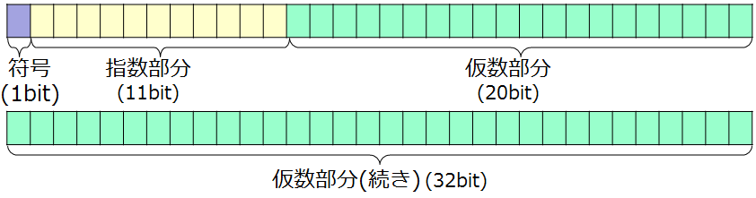

<!-- page 1 -->
# 計算機構成論 第12回

―算術演算の実行(3)―  
大連理工大学・立命館大学 国際情報ソフトウェア学部  
双見京介

<!-- page 2 -->
## 講義内容

算術演算の実行  
小数の2進数表記  
浮動小数点数の加算  
(浮動小数点数の乗算)  
誤差と丸め

<!-- page 3 -->
## 2進数の小数  復習

10進数と同様に小数点を用いる  
小数第1位が2-1に相当  
例) 11.112 = 1*21+1*20+1*2-1+1*2-2  
= 2+1+0.5+0.25  
= 3.7510  
0.00112 = 1*2-3+1*2-4  
= 0.125+0.0625  
= 0.187510

<!-- page 4 -->
## 2進数の小数の問題点  復習

誤差の発生  
例) 0.110 = 0.000110011001100...2  
= 0.0625 + 0.03125 + ...  
10進数の有限小数を有限桁で  
表すことができない！

<!-- page 5 -->
## 小数の2進数表記

固定小数点形式  
整数部分と小数部分のビット数を予め固定

|  | 26 | 25 | 24 | 23 | 22 | 21 | 20 | 2-1 | 2-2 | 2-3 | 2-4 | 2-5 | 2-6 | 2-7 | 2-8 |
| --- | --- | --- | --- | --- | --- | --- | --- | --- | --- | --- | --- | --- | --- | --- | --- |

符号 整数部分 小数部分  
利点：わかりやすい  
欠点：表現可能な値の範囲が狭い  
上の例での表現可能な小数部分の最小値(非零): 2-8  
上の例での最大の絶対値: 27-2-8 (=127.99609375)

<!-- page 6 -->
## 小数の2進数表記

科学記数法 (scientific notation)  
整数部分は1桁のみにする  
仮数 × 基数指数  という形式で表現  
(例) 3.141510 → 3.141510×100  
0.0123410  
→   1.23410×10-2  
315576000010 →   3.1557610×109  
**正規化**  
2進数でも、  
1.0101012 × 2-2 のように表記

<!-- page 7 -->
## 小数の2進数表記

浮動小数点 (floating point) 形式  
符号 指数部分 仮数部分

小数点の位置  
が流動的

表現可能な数値の幅が広い  
表現できる数の刻み幅が流動的  
e.g., 1.0×2-16, 1.0×215

<!-- page 8 -->
## 小数の2進数表記

浮動小数点 (floating point) 形式  
符号 指数部分 仮数部分  
表現可能な数値の幅が広い  
But  
オーバーフローは発生する  
数値の指数が指数部分に収まりきらなくなること  
アンダーフローも発生する  
負の指数が大きすぎて指数部分に収まりきらなくなる

<!-- page 9 -->
## 浮動小数点形式の数値表現

IEEE754による規定 **(-1)符号×(1+仮数)×2(指数-ゲタ)**  
単精度 (32bit)     C言語のfloat型に相当  
符号 指数部分 仮数部分  
(1bit) (8bit) (23bit)  
倍精度 (64bit)     C言語のdouble型に相当  
符号 指数部分  
仮数部分  
(1bit) (11bit) (20bit)  
仮数部分(続き) (32bit)

<!-- page 10 -->
## 浮動小数点形式の数値表現

単精度  
**(-1)符号×(1+仮数)×2(指数-ゲタ)**  
正規化後、仮数(2進数)の先頭は必ず1  
→仮数部分23bitの中では持たない  
仮数部は0～1の小数を示す  
指数ビットで大小比較ができない  
下駄(げた):伝統的な木製の履物  
\-1:11111111, 1:00000001  
→ 最小値が00000001になるように 下駄を履(は)かせる：本来の数量にある数量を加えて、  
ゲタ(bias)を履かせる  
全体の数量を実際より多く見せる  
単精度の場合、実際の値 +127 の値を指数部で保持  
単精度の 最小値は、1.00..002×2-126 、最大値は、1.11..112×2127

<!-- page 11 -->
## 浮動小数点形式の数値表現

倍精度  
**(-1)符号×(1+仮数)×2(指数-ゲタ)**

正規化後、仮数(2進数)の先頭は必ず1  
仮数部は0～1の小数を示す  
指数部分にはゲタ(1023)を履かせる  
倍精度の 最小値は、1.00..002×2-1022 、最大値は、1.11..112×21023

<!-- page 12 -->
## 浮動小数点形式の数値表現

特別な値の表現

| 指数 | 仮数 | 内容 |
| ----- | --- | -------- |
| 全て0 | 0 | 0 |
| 全て0 | ≠0 | ±不正規化数 |
| 1-254 | 任意 | ±浮動小数点数 |
| 全て1 | 0 | ±∞ |
| 全て1 | ≠0 | 非数 (NaN) |

※不正規化数：0に近い値を表現

<!-- page 13 -->
## 確認問題

|  | 符号 | 指数部分 | 仮数部分 |
| --- | ---- | ----- | ----- |
| 単精度 | 1bit | 8bit | 23bit |
| 倍精度 | 1bit | 11bit | 52bit |

(1) -0.7510を単精度で表現せよ。  
(2) 0.7510を倍精度で表現せよ。  
(3) 1.7510を単精度で表現せよ。  
(4) -∞を倍精度で表現せよ。  
(5) 単精度の場合のNaNの指数部を答えよ。

<!-- page 14 -->
## 確認問題

|  | 符号 | 指数部分 | 仮数部分 |
| --- | ---- | ----- | ----- |
| 単精度 | 1bit | 8bit | 23bit |
| 倍精度 | 1bit | 11bit | 52bit |

(1) -0.7510を単精度で表現せよ。  
\-0.7510=-0.112=-1.12×2-1 → 指数部は-1+127  
(2) 0.7510を倍精度で表現せよ。  
指数部は-1+1023  
(3) 1.7510を単精度で表現せよ。  
1.7510=1.112×20 → 指数部は0+127  
(4) -∞を倍精度で表現せよ。  
(5) 単精度の場合のNaNの指数部を答えよ。

<!-- page 15 -->
## 確認問題

単精度・倍精度の符号・指数部分・仮数部分の  
ビット幅は覚えなくても良いですが、  
**ゲタは自分で導出できるようになっておいてください**  
(2n-1-1) (n:指数部のビット数)

<!-- page 16 -->
## 講義内容

算術演算の実行  
小数の2進数表記  
浮動小数点数の加算  
(浮動小数点数の乗算)  
誤差と丸め

<!-- page 17 -->
## 浮動小数点の加算

開始  
小数点の位置合わせ  
(指数が小さい方をシフト)  
仮数の加算  
正規化  
オーバーフロー、  
アンダーフロー発生  
それ以外  
仮数の有効桁合わせ 例外  
非正規  
それ以外  
終了

<!-- page 18 -->
## 浮動小数点の加算

簡単のため、10進数で説明。  
仮数4桁、指数2桁と仮定。  
開始  
9.99910×101+1.61010×10-1  
小数点の位置合わせ  
9.99910×101+0.01610×101  
(指数が小さい方をシフト)  
4桁しか保持できない  
仮数の加算  
10.01510×101  
正規化  
1.001510×102  
オーバーフロー、  
それ以外  
アンダーフロー発生  
仮数の有効桁合わせ 例外 1.00210×102  
4桁に丸める(round)  
非正規  
それ以外  
終了

<!-- page 19 -->
## 浮動小数点の加算ユニット

| S | 指数 | 仮数 |
| --- | --- | --- |

| S | 指数 | 仮数 |
| --- | --- | --- |

MUX1 MUX2  
MUX3  
指数の差 小さい方の仮数  
大きい方の仮数  
右にシフト  
制御  
大きい方の指数  
MUX4  
MUX5  
減少/増大 左or右シフト  
丸め用HW

| S | 指数 | 仮数 |
| --- | --- | --- |

<!-- page 20 -->
## 浮動小数点の加算ユニット 小数点の位置を合わせる

| S | 指数 | 仮数 |
| --- | --- | --- |

| S | 指数 | 仮数 |
| --- | --- | --- |

MUX1 MUX2  
MUX3  
指数の差 小さい方の仮数  
大きい方の仮数  
右にシフト  
制御  
大きい方の指数  
MUX4  
MUX5  
減少/増大 左or右シフト  
丸め用HW

| S | 指数 | 仮数 |
| --- | --- | --- |

<!-- page 21 -->
## 浮動小数点の加算ユニット 仮数の加算

| S | 指数 | 仮数 |
| --- | --- | --- |

| S | 指数 | 仮数 |
| --- | --- | --- |

MUX1 MUX2  
MUX3  
指数の差 小さい方の仮数  
大きい方の仮数  
右にシフト  
制御  
大きい方の指数  
MUX4  
MUX5  
減少/増大 左or右シフト  
丸め用HW

| S | 指数 | 仮数 |
| --- | --- | --- |

<!-- page 22 -->
## 浮動小数点の加算ユニット 正規化

| S | 指数 | 仮数 |
| --- | --- | --- |

| S | 指数 | 仮数 |
| --- | --- | --- |

MUX1 MUX2  
MUX3  
指数の差 小さい方の仮数  
大きい方の仮数  
右にシフト  
制御  
大きい方の指数  
MUX4  
MUX5  
減少/増大 左or右シフト  
丸め用HW

| S | 指数 | 仮数 |
| --- | --- | --- |

<!-- page 23 -->
## 浮動小数点の加算ユニット 仮数の有効桁合わせ

| S | 指数 | 仮数 |
| --- | --- | --- |

| S | 指数 | 仮数 |
| --- | --- | --- |

MUX1 MUX2  
MUX3  
指数の差 小さい方の仮数  
大きい方の仮数  
右にシフト  
制御  
大きい方の指数  
MUX4  
MUX5  
減少/増大 左or右シフト  
丸め用HW

| S | 指数 | 仮数 |
| --- | --- | --- |

<!-- page 24 -->
## 浮動小数点の加算ユニット 非正規ならやり直し

| S | 指数 | 仮数 |
| --- | --- | --- |

| S | 指数 | 仮数 |
| --- | --- | --- |

MUX1 MUX2  
MUX3  
指数の差 小さい方の仮数  
大きい方の仮数  
右にシフト  
制御  
大きい方の指数  
MUX4  
MUX5  
減少/増大 左or右シフト  
丸め用HW

| S | 指数 | 仮数 |
| --- | --- | --- |

<!-- page 25 -->
## 講義内容

算術演算の実行  
小数の2進数表記  
浮動小数点数の加算  
(浮動小数点数の乗算)  
誤差と丸め

<!-- page 26 -->
## 浮動小数点の乗算  (発展)

人間の乗算と同様に行う  
指数同士を加算(ゲタに注意)  
仮数の計算  
正規化  
丸め  
符号の決定  
詳細は教科書で確認を  
(興味があれば図書館で確認してください)

<!-- page 27 -->
## 講義内容

算術演算の実行  
小数の2進数表記  
浮動小数点数の加算  
(浮動小数点数の乗算)  
誤差と丸め

<!-- page 28 -->
## 誤差と丸め

倍精度で1と2の間で表現できる数の個数は？  
252-1個  
   →それ以上の個数は表現できないので、  
一番近い表現で表すしかない  
｢丸める｣  
数値を四捨五入or切り上げor切り捨てして、  
指定した桁に収めること  
四捨五入  1.4→1.0  1.5→2.0  
切り上げ  1.4→2.0  1.5→2.0  
切り捨て  1.4→1.0  1.5→1.0  
本来表現するべき値との誤差(丸め誤差)が発生

<!-- page 29 -->
## 誤差と計算

仮数の有効桁を3桁とするとき、  
2.2610×100+2.3410×102+1.2610×100 はどうなるか？  
途中も有効桁3桁 途中は有効桁5桁  
0.020010 ×102  
0.022610 ×102  
2.340010 ×102  
2.340010 ×102  
\+ 0.010010 ×102 + 0.012610 ×102  
2.370010 ×102  
2.375210 ×102  
2.3710 ×102  
2.3810 ×102  
**IEEE754では、計算途中では2桁余分に保持するように規定**

<!-- page 30 -->
## 情報落ち

(-1.510×1038) + ((1.510×1038) + (1)) ((-1.510×1038) + (1.510×1038)) + (1)  
...+((1.510×1038) + **0.00...**×1038)  
0+1  
=0 =1  
絶対値の大きい数と小さい数を  
計算の順番によって、  
足したとき、絶対値が小さい数が  
誤差を回避できる可能性がある  
無視されてしまう

<!-- page 31 -->
## 桁落ち

浮動小数点数の演算において、  
有効桁数が少なくなる現象  
ごく近い数値同士の減算、計算結果が0に  
近くなる加減算によって発生  
√1001- √999  
= (3.163858410×101) - (3.160696110×101) ←有効桁8桁  
= (3.162310×10-2)  
←有効桁5桁  
= (3.162300010×10-2) ←0を埋めると有効桁8桁に見えるが...  
本当の差は...  
3.16227805545…×10-2

<!-- page 32 -->
## 確認問題

科学記数法では、**(1)** × **(2)(3)** という形式で小数を  
表現する。  
IEEE754では、32ビットの**(4)**精度と  
64ビットの**(5)**精度がある。  
IEEE754では、計算途中は有効桁を**(6)**桁余分に  
保持している。  
数値を丸めることによって発生する誤差を、**(7)**という。  
ごく近い値の浮動小数点数の減算等において、計算結果  
の有効桁数が少なくなる現象を**(8)**という。  
絶対値の大きい数と小さい数を足したとき、絶対値が  
小さい数が0になってしまうことを、**(9)**という。

<!-- page 33 -->
## 確認問題

<!-- page 34 -->
## 参考文献

コンピュータの構成と設計 上 第5版  
David A.Patterson, John L. Hennessy 著、  
成田光彰 訳、日経BP社  
山下茂 「計算機構成論１」講義資料
