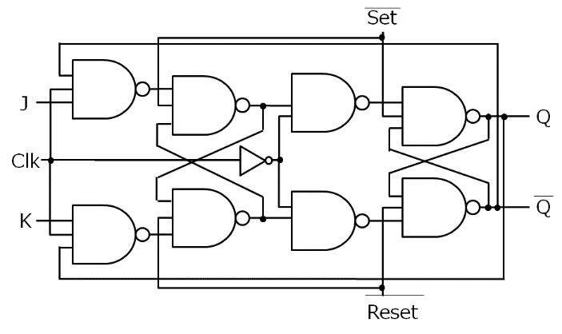
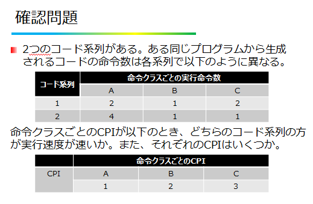
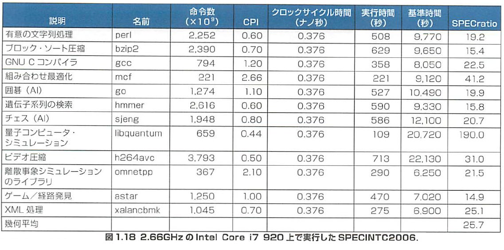
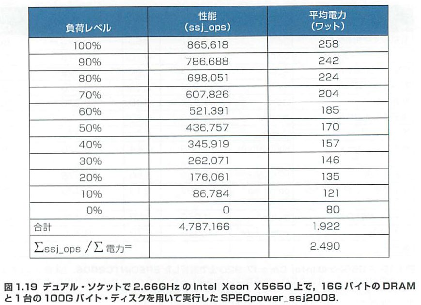
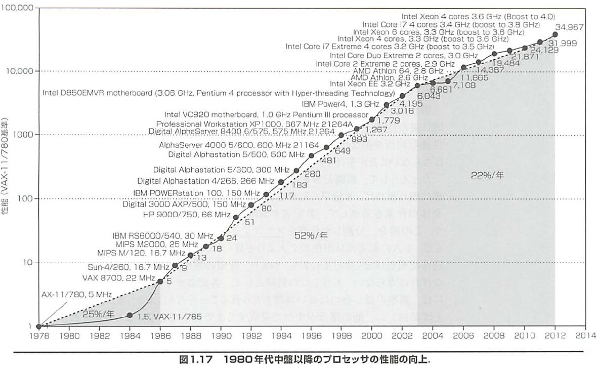

<!-- page 1 -->
# 計算機構成論 第13回

―性能評価―  
大連理工大学・立命館大学 国際情報ソフトウェア学部  
双見京介

<!-- page 2 -->
## 講義内容

性能評価  
スループット、応答時間、CPU実行時間  
クロック・サイクルとCPI  
MIPS  
ベンチマーク  
アムダールの法則  
ムーアの法則

<!-- page 3 -->
## スループットと応答時間

スループット (throughput)  
単位時間あたりに終了した作業量  
応答時間 (response time)  
コンピュータがタスクを完了させるのに  
必要な時間  
ディスク・アクセス、メモリ・アクセス、  
入出力動作、OSのオーバヘッド、CPU実行時間  
等を含む  
Q. 以下の場合、スループット、応答時間のどちらが  
(あるいは両方)が改善するか？  
1. プロセッサを高速なものに取り替える  
2. 複数プロセッサを使用してタスクを分担しているシステムに  
プロセッサを追加する

<!-- page 4 -->
## 実行時間の内訳

あるコンピュータXに関して以下が成立  
性能X＝ 1 実行時間が半分 ※ここでの「性能」は、  
実行時間X ＝ 性能が2倍 時間的な性能  
実行時間=応答時間=経過時間  
ディスク・アクセス、メモリ・アクセス、  
入出力動作、CPU実行時間等  
CPU(実行)時間 = システムCPU時間  
                         \+ ユーザCPU時間  
ユーザCPU時間：  
CPUがあるユーザプログラムに関して、実際に処理を行った時間  
システムCPU時間：  
OSのオーバヘッドの作業時間

<!-- page 5 -->
## CPU実行時間

あるプログラムのCPU実行時間＝  
そのプログラム実行に必要な  
CPUクロック・サイクル数×  
クロック・サイクル時間  
1  
クロック・サイクル時間(秒)=  
クロック周波数 (Hz)

H  
CLK  
L  
JK-FF

<!-- page 6 -->
## 確認問題

単位時間あたりに終了した作業量を  
**(1)**と呼ぶ。  
CPU実行時間=  
**(2)**CPU時間+**(3)**CPU時間  
プログラムXの実行に必要なCPUクロック・  
サイクル数が10000であり、クロック・サイクル  
時間が0.3ナノ秒の時、プログラムX終了までの  
CPU実行時間は**(4)**マイクロ秒。  
クロック・サイクル時間が0.25ナノ秒の時、  
クロック周波数は**(5)**GHz。

<!-- page 7 -->
## 確認問題

<!-- page 8 -->
## 講義内容

性能評価  
スループット、応答時間、CPU実行時間  
クロック・サイクルとCPI  
MIPS  
ベンチマーク  
アムダールの法則  
ムーアの法則

<!-- page 9 -->
## 命令の実行にかかるクロック・サイクル数

複雑な命令(乗算、除算等)には複数  
クロック・サイクルが必要  
パイプライン処理などを使う場合、状況により  
必要なCPUクロック・サイクル数は変化する  
CPI (clock cycles per instruction)  
命令あたりの平均クロック・サイクル数  
普通、一つのプログラム全体での平均を取る  
あるプログラムの実行に必要な  
CPUクロック・サイクル数 ＝ 命令数 × CPI

<!-- page 10 -->
## 確認問題

同じ命令セットアーキテクチャを実現した  
以下の2種類のコンピュータがあるとする。

|  | クロック・サイクル時間 | あるプログラムXでのCPI |
| ------- | ----------- | ------------- |
| コンピュータA | 250ps | 2.0 |
| コンピュータB | 500ps | 1.2 |

どちらのコンピュータが、どれだけ速いか？  
「□の方が□倍速い」という形で  
答えてください

<!-- page 11 -->
## 確認問題

同じ命令セットアーキテクチャを実現した  
以下の2種類のコンピュータがあるとする。

|  | クロック・サイクル時間 | あるプログラムXでのCPI |
| ------- | ----------- | ------------- |
| コンピュータA | 250ps | 2.0 |
| コンピュータB | 500ps | 1.2 |

どちらのコンピュータが、どれだけ速いか？  
1命令に要する時間は  
コンピュータAは 250×? = ps  
コンピュータBは 500×? = ps  
よって、。

<!-- page 12 -->
## 確認問題

2つのコード系列がある。ある同じプログラムから生成  
されるコードの命令数は各系列で以下のように異なる。

| コード系列 | 命令クラスごとの実行命令数 |  |  |
| ----- | ------------- | --- | --- |
|  | A | B | C |
| 1 | 2 | 1 | 2 |
| 2 | 4 | 1 | 1 |

命令クラスごとのCPIが以下のとき、どちらのコード系列の方  
が実行速度が速いか。また、それぞれのCPIはいくつか。

|  | 命令クラスごとのCPI |  |  |
| --- | ----------- | --- | --- |
| CPI | A | B | C |
|  | 1 | 2 | 3 |

<!-- page 13 -->
## 確認問題

コード系列ごとに、1命令あたりの平均クロック数  
(平均CPI)を計算。  
コード系列1  
平均CPI =  
コード系列2  
平均CPI =  
**命令数が少ない方が速いとは限らない。**

<!-- page 14 -->
## 講義内容

性能評価  
スループット、応答時間、CPU実行時間  
クロック・サイクルとCPI  
MIPS  
ベンチマーク  
アムダールの法則  
ムーアの法則

<!-- page 15 -->
## MIPS

not MIPS architecture  
million instructions per second  
実行命令数  
MIPS =  
実行時間×106  
長所  
単位時間あたりの実行命令数に比例するので、  
直感的にわかりやすい  
短所  
命令の中身を考慮していない  
→ 異なる命令セット同士で比べられない  
同じコンピュータでもプログラムが違えば  
実行命令数が違ってくる

<!-- page 16 -->
## 確認問題

クロック周波数4GHzのCPUで、  
命令クラスごとのCPI、出現率が  
以下のとき、MIPS値はいくらか。

|  | 命令クラス |  |  |
| --- | ----- | --- | --- |
|  | A | B | C |
| CPI | 1 | 2 | 3 |
| 出現率 | 70% | 20% | 10% |

有効桁3桁で計算

<!-- page 17 -->
## 確認問題

クロック周波数4GHzのCPUで、  
命令クラスごとのCPI、出現率が  
以下のとき、MIPS値はいくらか。

|  | 命令クラス |  |  |
| --- | ----- | --- | --- |
|  | A | B | C |
| CPI | 1 | 2 | 3 |
| 出現率 | 70% | 20% | 10% |

1命令あたりの平均クロック数：  
(1*70+2*20+3*10)/100 = 1.4  
1秒あたりの実行命令数：  
?/ ?    ≒ 命令/秒 MIPS = 実行命令数  
MIPS値は 実行時間×106

<!-- page 18 -->
## 講義内容

性能評価  
スループット、応答時間、CPU実行時間  
クロック・サイクルとCPI  
MIPS  
ベンチマーク  
アムダールの法則  
ムーアの法則

<!-- page 19 -->
## ベンチマーク

どちらの方が良いか？  
計算機Aはプログラム1を1秒、プログラム2を1000秒  
計算機Bはプログラム1を10秒、プログラム2を100秒  
多くのプログラムで調べて平均を取ればいい  
→どんなプログラムに対して評価するか？  
ベンチマーク：  
コンピュータの性能評価を目的として選定された  
プログラム群  
SPEC (Standard Performance Evaluation Corporation)  
ベンチマークを策定している組織  
実際によく使われるアプリケーションがベンチマークとして採用  
最新版 SPEC CPU2017  
SPEC ratio  
基準プロセッサでの実行時間／測定対象での実行時間＝ 基準の何倍速いか  
2つの計算機間で比較するときは、SPEC ratioの幾何平均をとる

<!-- page 20 -->
## (例) Intel Core i7のベンチマーク

<!-- page 21 -->
## (例) 電力消費に関するベンチマーク

<!-- page 22 -->
## 講義内容

性能評価  
スループット、応答時間、CPU実行時間  
クロック・サイクルとCPI  
MIPS  
ベンチマーク  
アムダールの法則  
ムーアの法則

<!-- page 23 -->
## アムダールの法則 (Amdahl's law)

ある改善を行った結果の性能の向上は、改善  
した機能を使用する割合によって制約される。  
改善の影響を受ける実行時間  
改善の影響を受けない  
改善後の実行時間 =  
\+  
改善度 実行時間  
例：90％がCPU処理、10％がI/O処理  
10倍速いCPUを使うと全体の時間はどうなるか？  
100倍だと？  
無限に速いCPUだと？

<!-- page 24 -->
## ムーアの法則 (Moore's law)

1.5年で面積あたりのトランジスタ数が2倍に  
→容量・性能の向上、値段下落

<!-- page 25 -->
## 確認問題

以下の説明に合う用語を答えよ。  
1.5年で面積あたりのトランジスタ数が2倍に  
なるという法則(予測)  
ある改善を行った結果の性能の向上は、改善  
した機能を使用する割合によって制約される  
という法則  
コンピュータの性能評価を目的として  
選定されたプログラム群

<!-- page 26 -->
## 確認問題

以下の説明に合う用語を答えよ。  
1.5年で面積あたりのトランジスタ数が2倍に  
なるという法則(予測)  
ある改善を行った結果の性能の向上は、改善  
した機能を使用する割合によって制約される  
という法則  
コンピュータの性能評価を目的として  
選定されたプログラム群

<!-- page 27 -->
## 参考文献

コンピュータの構成と設計 上 第5版  
David A.Patterson, John L. Hennessy 著、  
成田光彰 訳、日経BP社  
山下茂 「計算機構成論１」講義資料  
画像は教科書からのスキャンです。  
転載・頒布を禁止します。
