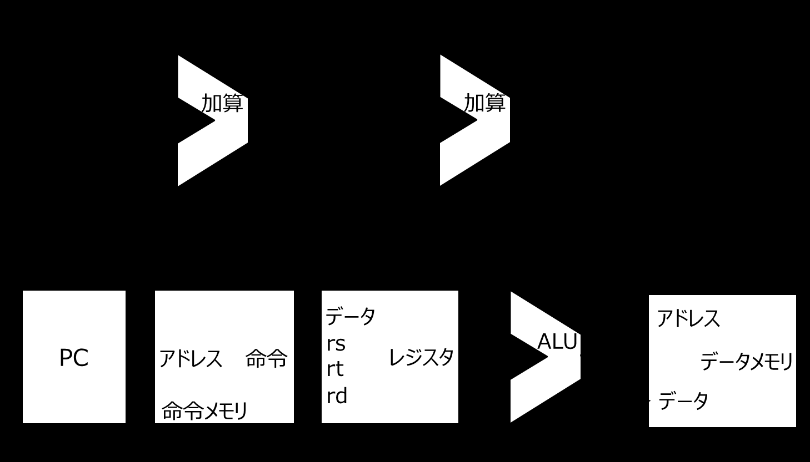
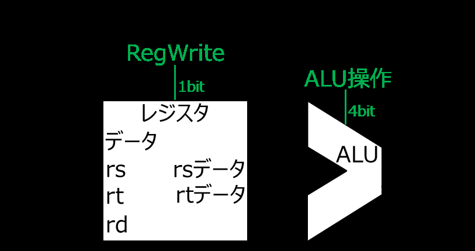
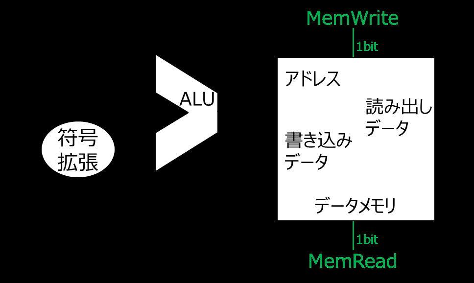
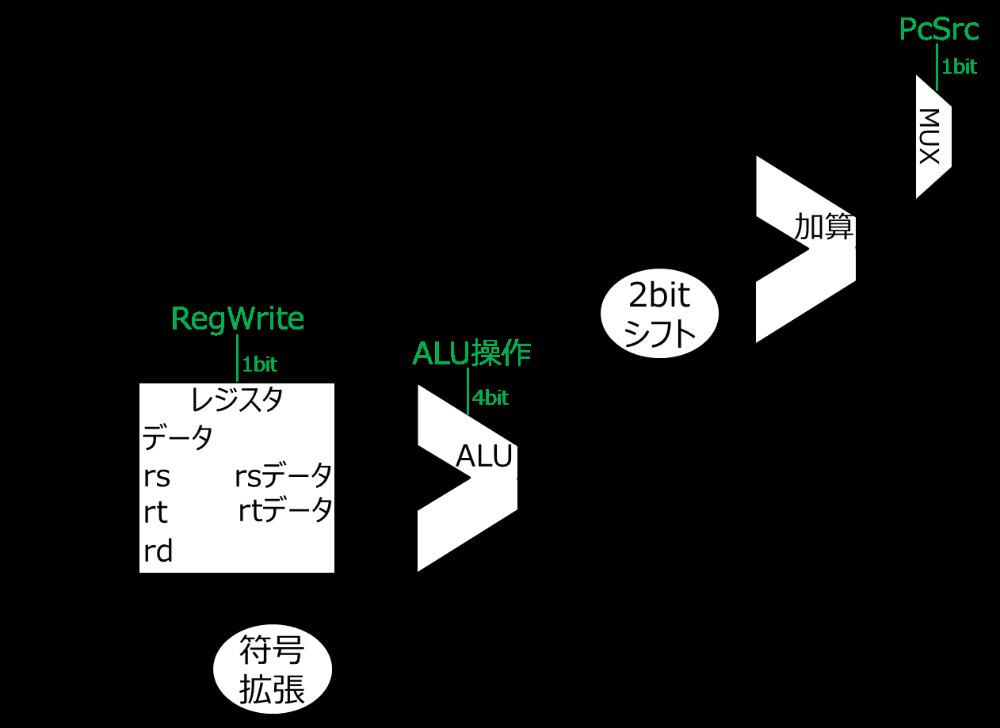
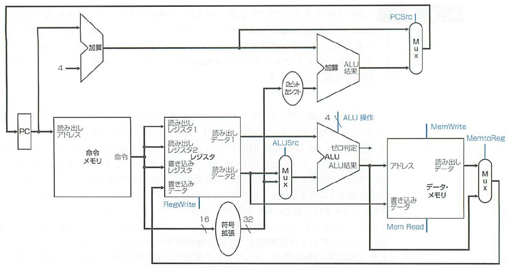
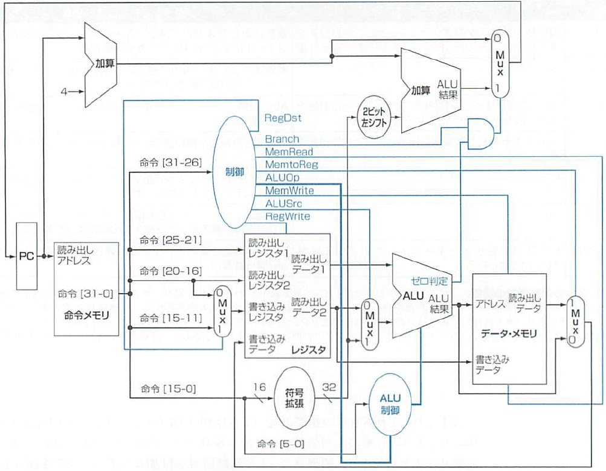
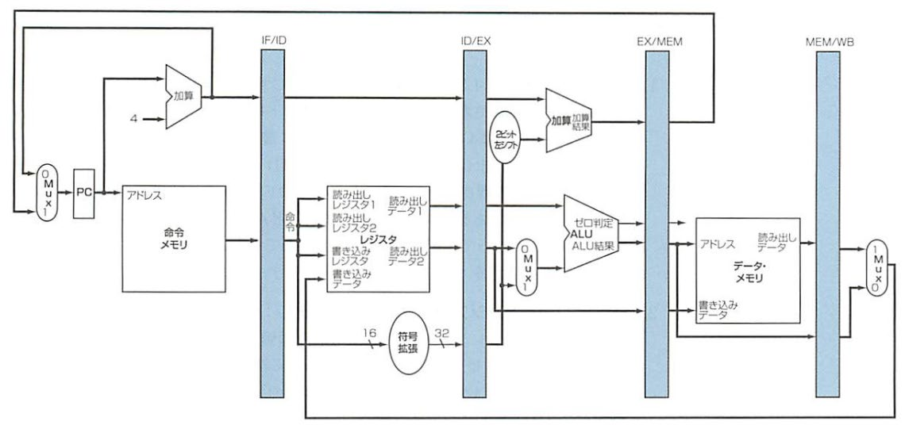

<!-- page 1 -->
# 計算機構成論 第14回

―パイプライン処理―  
大連理工大学・立命館大学 国際情報ソフトウェア学部  
双見京介

<!-- page 2 -->
## 講義内容

パイプライン処理  
概説  
データパスの構築  
パイプライン処理の実行  
パイプライン処理の問題点

<!-- page 3 -->
## さらなる性能の向上

計算機の性能の決定要因  
1. 単位時間あたりの実行命令数  
2. クロック・サイクル時間  
3. CPI (命令あたりのクロック・サイクル数)  
単位時間あたりの実行命令数を  
増やせないか？  
命令A

| 命令 読込 | レジ スタ | 計算 実行 |
| ----- | ----- | ----- |

パイプライン処理 命令B

| 命令 読込 | レジ スタ | 計算 実行 |
| ----- | ----- | ----- |

命令C

| 命令 読込 | レジ スタ | 計算 実行 |
| ----- | ----- | ----- |

<!-- page 4 -->
## 命令の実行

命令の実行段階  
メモリから命令を取り出す  
＝フェッチする (fetch)  
命令の内容をレジスタに転送  
PC(プログラムカウンタ)を4進める  
オペランドのレジスタの値を読み出す  
その後、命令ごとに異なる処理へ  
処理内容は結構似ている  
– 算術論理演算の実行 ＝ ALU使用  
– lw, sw → アドレス値加算 = ALU使用

<!-- page 5 -->
## MIPS命令実装方式の概念図

ここではlw, sw, add, sub,  
and, or, slt, beq命令のみ  
4  
加算 加算 考えます  
・  
データ ・ アドレス  
rs ALU  
PC ・ アドレス 命令 ・・ rt レジスタ データメモリ  
rd ・ データ  
命令メモリ

<!-- page 6 -->
## MIPS命令実装方式の概念図

マルチプレクサ(セレクタ)  
MUX制御  
4  
加算 加算  
・ A X  
MUX  
B  
読み出しか書き込みか  
を制御線で選択  
データ ・ アドレス  
rs ALU  
PC ・ アドレス 命令 ・・ rt レジスタ データメモリ  
rd ・ データ  
命令メモリ

<!-- page 7 -->
## 論理設計とクロック方式

計算機設計の際は、  
クロックの刻み方を決めないといけない  
組み合わせ論理要素  
内部状態を持たない (ALUなど)  
状態論理要素  
内部状態を持つ (レジスタやメモリなど)  
クロック・パルスごとに状態が進む  
エッジ・トリガ・クロック方式  
クロック・パルスの  
高低切り替わりの際に 状態論理 組み合わせ  
状態を進める 要素 論理回路

<!-- page 8 -->
## MIPS命令実装方式の概念図


4  
加算 加算  
・  
データ ・ アドレス  
rs ALU  
PC ・ アドレス 命令 ・・ rt レジスタ データメモリ  
rd ・ データ  
命令メモリ

<!-- page 9 -->
## 確認問題

次の説明に該当する用語を答えよ。  
複数の命令を時間的にずらして、  
並行的に実行する処理方式  
メモリから命令を取り出すこと  
クロック・パルスの高低切り替わりの際に  
状態論理要素の状態を進める方式  
制御信号により、複数の入力の中から  
1つを選んで出力する機構

<!-- page 10 -->
## 確認問題

次の説明に該当する用語を答えよ。  
複数の命令を時間的にずらして、  
並行的に実行する処理方式  
メモリから命令を取り出すこと  
クロック・パルスの高低切り替わりの際に  
状態論理要素の状態を進める方式  
制御信号により、複数の入力の中から  
1つを選んで出力する機構

<!-- page 11 -->
## 講義内容

パイプライン処理  
概説  
データパスの構築  
パイプライン処理の実行  
パイプライン処理の問題点

<!-- page 12 -->
## データパスの構築 命令のフェッチ

データパス(datapath)  
データの経路  
命令をフェッチして  
PCを進める部分の  
4  
加算 データパス



PC ・ アドレス 命令  
命令メモリ

<!-- page 13 -->
## データパスの構築 R形式の命令実行



レジスタ・ファイル  
(32個の汎用レジスタ)

<!-- page 14 -->
## データパスの構築 lw/sw命令の実行



<!-- page 15 -->
## データパスの構築 分岐命令の実行



<!-- page 16 -->
## データパスの構築 各部の統合



<!-- page 17 -->
## データパスの構築 さらに詳細化



<!-- page 18 -->
## データパス (パイプライン・レジスタ有)



IF:  命令フェッチ  
ID:  命令デコードとレジスタフェッチ  
パイプライン・ステージごとに  
EX:  命令実行／アドレス生成  
パイプライン・レジスタが設置される  
MEM:  データメモリアクセス  
WB:  書き込み

<!-- page 19 -->
## 講義内容

パイプライン処理  
概説  
データパスの構築  
パイプライン処理の実行  
パイプライン処理の問題点

<!-- page 20 -->
## さらなる性能の向上  再掲

計算機の性能の決定要因  
1. 単位時間あたりの実行命令数  
2. クロック・サイクル時間  
3. CPI (命令あたりのクロック・サイクル数)  
単位時間あたりの実行命令数を  
増やせないか？  
命令A

| 命令 読込 | レジ スタ | 計算 実行 |
| ----- | ----- | ----- |

パイプライン処理 命令B

| 命令 読込 | レジ スタ | 計算 実行 |
| ----- | ----- | ----- |

命令C

| 命令 読込 | レジ スタ | 計算 実行 |
| ----- | ----- | ----- |

<!-- page 21 -->
## パイプライン処理の実行イメージ

0 200 400  
600 800 1000 1200 1400 1600 時間  
命令1  
命令2  
0 200 400  
600 800 1000 1200 1400 1600 時間  
命令1  
命令2  
命令3  
パイプラインは個々の命令を完了させるのにかかる時間(レイテンシ, latency)を  
短縮するわけではない

<!-- page 22 -->
## 講義内容

パイプライン処理  
概説  
データパスの構築  
パイプライン処理の実行  
パイプライン処理の問題点

<!-- page 23 -->
## パイプライン処理の問題点

データ・ハザード data hazards  
命令の実行に必要なデータが  
まだ利用可能でないため、  
予定している命令を実行できないこと

```
add $s0, $t0, $t1
sub $t2, $s0, $t3
```

   フォワーディング（バイパシング）                              ：forwarding (bypassing)  
計算結果をすぐに使えるようにする  
コードの並べ替え：  
コードの実行順を変えることでストールを回避  
パイプライン・ストール：  
stall[V/N]行き詰まること  
実行を待機して、計算結果が来るのを待つ  
(NOP命令 (何もしない命令) の導入)  
→ 実行が遅くなるので、できるだけ避ける

<!-- page 24 -->
## パイプライン処理の問題点

構造ハザード structural hazards  
パイプライン処理において、  
命令の実行に必要なハードウェアが  
競合するため、予定された命令を  
実行できないこと  
e.g., 複数の命令で同時にメモリの読み書き  
競合する命令を遅らせるなどして対処

<!-- page 25 -->
## パイプライン処理の問題点

制御ハザード control hazards  
条件分岐が存在するため、命令を  
実行するべきかどうか判断できず、  
所定のクロック・サイクル内で命令を  
実行できないこと  
分岐ハザードともいう  
  予測：  
分岐の結果を予測(例えば、常に条件不成立)  
して命令の実行を進めておく

<!-- page 26 -->
## 確認問題

以下の各文は正しいか。○か×で答えよ。  
パイプライン処理では、命令を1つずつ、  
直列的に実行する。  
パイプライン処理によって、  
各命令の実行に必要な時間を  
減らすことができる。  
パイプライン処理は、  
スループットの向上を目標としている。  
パイプライン処理において、必要なデータが  
まだ利用可能でないため、命令を実行  
できないことを分岐ハザードという。

<!-- page 27 -->
## 確認問題

以下の各文は正しいか。○か×で答えよ。  
パイプライン処理では、命令を1つずつ、  
直列的に実行する  
パイプライン処理によって、  
各命令の実行に必要な時間を  
減らすことができる。  
パイプライン処理は、  
スループットの向上を目標としている。  
パイプライン処理において、必要なデータが  
まだ利用可能でないため、命令を実行  
できないことを制御ハザードという。

<!-- page 28 -->
## さらなる学習

実行に時間がかかる命令（乗除算など）を  
パイプラインで扱うには？  
通常のパイプラインとは別に処理する etc.  
キャッシュの利用  
記憶階層の実現  
仮想記憶（2次記憶をキャッシュとして使う）  
並列処理  
スーパースカラ  
ハードウェア・マルチスレッディング

<!-- page 29 -->
## 参考文献

コンピュータの構成と設計 上 第5版  
David A.Patterson, John L. Hennessy 著、  
成田光彰 訳、日経BP社  
コンピュータの構成と設計 下 第5版  
David A.Patterson, John L. Hennessy 著、  
成田光彰 訳、日経BP社  
画像は教科書からのスキャンです。  
転載・頒布を禁止します。
